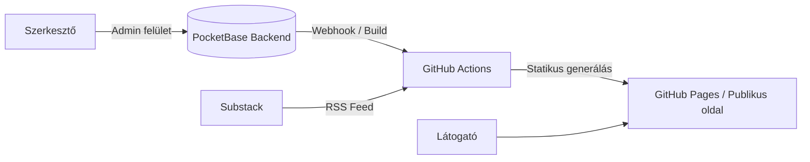

# Alacsony költségű headless CMS és statikus weboldalgenerátor specifikáció

## 1. Szereplők és jogosultságok

| Szerep | Igény | Felelősség / hozzáférés |
| --- | --- | --- |
| Tartalomszerkesztő / Adminisztrátor | Oldalak, strukturált adatok és fájlok biztonságos kezelése, publikálás | Bejelentkezik az adminisztrációs felületre, létrehozza/módosítja a normál oldalakat, feltölti a fájlokat, és kezdeményezi a publikálást. Teljes hozzáférése van a CMS API-hoz és a szerkesztőfelülethez. |
| Publikus Látogató | A statikusan generált, gyors weboldal megtekintése | Eléri a publikus weboldalat, böngészi a normál oldalakat és a külső szolgáltatótól (pl. Substack) származó blogbejegyzéseket. Nincs hozzáférése adminisztrációs funkciókhoz vagy belső adatokhoz. |

## 2. Use case-ek / user storyk

### Oldal létrehozása, szerkesztése és publikálása

- **Szereplő:** Tartalomszerkesztő
- **Előfeltétel:** A szerkesztő sikeresen bejelentkezett az adminisztrációs felületre.
- **Fő folyamat:**
  1. A szereplő kiválasztja az oldalak kezelését, majd új oldal létrehozását kezdeményezi.
  2. Megadja a kötelező metaadatokat (cím, slug/URL, státusz: *piszkozat* vagy *publikált*, valamint a tartalmi blokkokat).
  3. A rendszer érvényesíti a mezőket és elmenti az adatokat a PocketBase backendbe.
  4. A szerkesztő a "Publikálás" gombra kattint, ami webhookon keresztül vagy manuálisan elindítja a GitHub Actions build folyamatot.
  5. A generátor lekéri a publikált oldalakat, integrálja a külső blog feedjét, és legenerálja a statikus weboldalt a GitHub Pages hosting felületére.
- **Alternatív / hibafolyamatok:** Ha egy kötelező mező (pl. slug) üres vagy érvénytelen karaktert tartalmaz, a rendszer hibaüzenetet jelenít meg, és nem menti a módosítást.
- **Utófeltétel:** A frissített tartalom megjelenik a statikusan generált publikus weboldalon.

### Fájlfeltöltés és beillesztés

- **Szereplő:** Tartalomszerkesztő
- **Fő folyamat:**
  1. A szerkesztő kiválaszt egy fájlt (pl. képet) az adminisztrációs felületen.
  2. A rendszer ellenőrzi a fájl formátumát és méretét, majd feltölti a PocketBase média tárolójába.
  3. A rendszer visszaadja a fájl elérési útvonalát/URL-jét, amelyet a szerkesztő beilleszthet az oldal tartalmába.

## 3. Funkcionális követelmények

| Követelmény | Elfogadási kritérium | Prioritás |
| --- | --- | --- |
| Felhasználói regisztráció és hitelesítés | Adott hitelesítési adatokkal a szerkesztő biztonságosan bejelentkezhet az adminisztrációs felületre; jogosultság nélkül az admin funkciók nem érhetők el. | Kötelező |
| Site-ok, oldalak és strukturált adatok kezelése | A rendszer támogatja a normál oldalak, metaadatok (slug, státusz) és szerkeszthető blokkok CRUD műveleteit. | Kötelező |
| Fájlok feltöltése és tárolása | A szerkesztő képeket és fájlokat tölthet fel, listázhat és használhat a tartalmakban. | Kötelező |
| Külső blog integráció build időben | A generátor lekéri és megjeleníti a külső blog (pl. Substack) bejegyzéseit a build folyamat során. | Kötelező |
| Headless tartalom-API | A PocketBase REST API-n keresztül jól definiált határ biztosítja a tartalom lekérését a generátor számára. | Kötelező |
| Egyedi publikus weboldalsablon | Legalább egy Vue vagy SvelteKit alapú sablon jeleníti meg a statikus oldalt. | Kötelező |
| Statikus oldalgenerálás és publikálás | A publikált tartalomból és a kiválasztott sablonból a rendszer tiszta statikus HTML/CSS/JS kimenetet generál. | Kötelező |
| Validáció és hibakezelés | A rendszer egyértelmű üzenetet ad érvénytelen tartalom, sikertelen fájlművelet vagy build hiba esetén. | Kötelező |

Prioritás: **Kötelező** = a végtermékhez szükséges; **Ajánlott** = fontos; **Lehetséges** = idő esetén opcionális.

## 4. Üzleti szabályok és korlátok

| Szabály vagy korlát | Indoklás |
| --- | --- |
| A publikus oldalon csak a *publikált* státuszú oldalak jelenhetnek meg. | Biztosítja, hogy a piszkozatok ne szivárogjanak ki a nyilvánossághoz. |
| Titkos kulcsok és emelt jogosultságú tokenek nem kerülhetnek a klienskódba. | Megakadályozza a backend adatok és admin funkciók illetéktelen elérését. |
| A külső blogbejegyzéseket a CMS nem szerkeszti, csak integrálja. | Megfelel a brief követelményeinek (külső szolgáltató használata). |
| A generált publikus oldalnak alkalmazásszerver nélkül, statikusan kell futnia. | Garantálja az alacsony fenntartási költséget és a gyors betöltődést. |

## 5. Felhasználói felület és munkafolyamat

A rendszer két fő felületre oszlik:
1. **Adminisztrációs felület:** Statikusan kiszolgált SPA, amely bejelentkezés után listázza a site-okat, oldalakat, médiát, valamint biztosítja a szerkesztőeszközöket és a publikálási indítógombot.
2. **Publikus weboldal:** SvelteKit/Vue alapú, statikusan generált oldal, amely a látogatók számára szolgálja ki a tartalmat és a külső blogbejegyzéseket.

## 6. Nem funkcionális követelmények

| Követelmény | Ellenőrzés módja |
| --- | --- |
| A publikus oldal betöltési ideje normál hálózaton 1.5 másodperc alatt van. | Böngészős teljesítménymérés (Lighthouse / DevTools). |
| Az adminisztrációs API hívások jelszóalapú tokennel védettek, illetéktelenek nem olvashatják a nem publikus adatokat. | Manuális és automata jogosultsági tesztek. |
| A backend minimális erőforrásigényű (alacsony RAM- és CPU-használat). | PocketBase erőforrás-monitorozás tesztkörnyezetben. |
| Sikertelen fájlfeltöltés vagy érvénytelen formátum esetén a rendszer nem omlik össze, hanem hibaüzenetet ad. | Negatív tesztek futtatása a fájlkezelő modulon. |

## 7. Nyitott kérdések és kockázatok

| Kérdés / kockázat | Hatás | Felelős | Feloldás / döntés |
| --- | --- | --- | --- |
| Hogyan történjen a legfrissebb Substack RSS feed lekérése build időben? | Befolyásolja a statikus generálás sebességét és megbízhatóságát. | Hallgató | RSS parser könyvtár használata Node.js-ben a build script részeként. |
| Hogyan indítható el automatikusan a GitHub Actions build a PocketBase-ből? | Befolyásolja a publikálás kényelmét. | Hallgató | PocketBase webhook konfigurálása, amely meghívja a GitHub Repository Dispatch API-t. |

## 8. Kezdeti technikai javaslat

### Javasolt megoldás

A rendszer alapja egy saját üzemeltetésű vagy ingyenes felhőben futó **PocketBase** backend, egy statikus adminisztrációs felület, valamint egy **SvelteKit** alapú statikus generátor, amely a GitHub Actions segítségével építi és telepíti a weboldalt a GitHub Pages-re.

### Technológiai irány

| Terület | Jelölt technológia / megközelítés | Megfontolás oka |
| --- | --- | --- |
| Backend & Adattárolás | PocketBase (SQLite) | Minimális RAM/CPU igény, beépített auth, fájltárolás és REST API. |
| Admin felület & Sablon | SvelteKit / Vue + TypeScript | Kiváló statikus export, típusbiztonság, gyors fejlesztés. |
| Automatikus publikálás | GitHub Actions + GitHub Pages | Ingyenes, megbízható CI/CD pipeline statikus oldalakhoz. |

### Kezdeti architektúravázlat

### Megvalósíthatóság és technikai kockázatok

| Kockázat / feltételezés | A projektre tervezett validáció | Tartalék megközelítés |
| --- | --- | --- |
| A PocketBase webhook megbízhatóan és azonnal indítja a GitHub Actions buildet. | Teszt webhook bekötése és a build indulási idejének, valamint sikerességének mérése tartalomváltozáskor. | Időzített (cron-alapú) napi/órás automatikus build, vagy egy kényelmes manuális "Publikálás" gomb az admin felületen. |
| A külső blog (pl. Substack) RSS feedje formátumváltozás miatt hibára futtathatja a buildet. | Egy dedikált RSS-feldolgozó szkript írása és tesztelése többféle hírforrással build időben. | Robusztus hibakezelés (try-catch), amely hiba esetén a legutolsó sikeresen letöltött cache-elt adatokat vagy alapértelmezett üzenetet használ. |
| A PocketBase saját üzemeltetése (vagy ingyenes tárhelye) stabilan fut leállás nélkül. | A backend lokális tesztelése, valamint egy ingyenes felhős (pl. Fly.io / Render) tesztpéldány folyamatos figyelése. | Második, könnyen migrátható SQLite alapú mentési stratégia vagy egyszerűbb JSON-alapú fallback. |